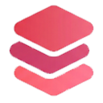
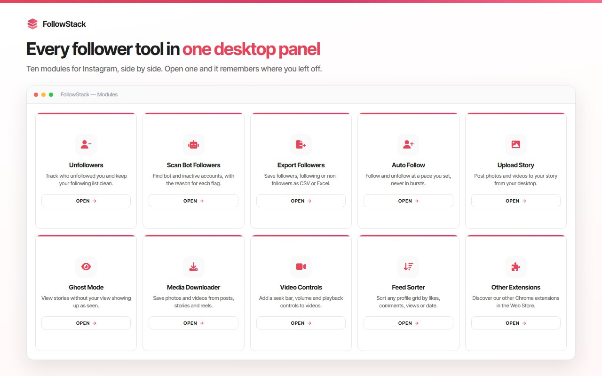
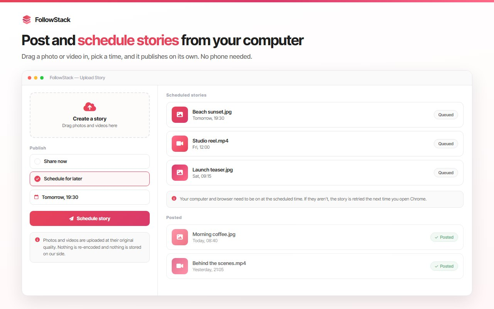

# FollowStack: Desktop Toolkit for Managing an Instagram Account from Your PC

FollowStack is a free Chrome extension that brings a set of account management tools to the Instagram website on desktop. It is built for creators, social media managers and agencies who would rather work at a computer than on a phone: track who does not follow back, post stories from your PC, export follower lists and more, all in one panel.

**[Install from the Chrome Web Store](https://chromewebstore.google.com/detail/jknceimegjghfdkmfeghimicphnbdkha?utm_source=github&utm_medium=readme&utm_campaign=followstack)** | **[Full guide and FAQ](https://www.addonschrome.com/extensions/followstack-instagram-toolkit-for-desktop.html?utm_source=github&utm_medium=readme&utm_campaign=followstack)** | **[Video demo](https://www.youtube.com/watch?v=evvqpYkIlhw)**

This repository is the public home for FollowStack documentation, release notes and the issue tracker. The extension itself is distributed through the Chrome Web Store.

## Tools in the panel

- **Unfollowers tracker:** see who does not follow you back
- **Story upload from PC:** post stories from your computer
- **Ghost and fake follower detection:** spot inactive accounts before you clean up
- **List export:** save follower and following lists to CSV, Excel or JSON
- **Video controls:** extra playback controls on the desktop site
- More modules are listed on the [extension page](https://www.addonschrome.com/extensions/followstack-instagram-toolkit-for-desktop.html?utm_source=github&utm_medium=readme&utm_campaign=followstack); you switch on only the ones you need

## How to use it

1. Install FollowStack from the [Chrome Web Store](https://chromewebstore.google.com/detail/jknceimegjghfdkmfeghimicphnbdkha?utm_source=github&utm_medium=readme&utm_campaign=followstack).
2. Open Instagram in your browser on desktop while logged in.
3. Open the FollowStack panel and enable the tools you want.

No extra software is needed, and the extension does not ask for your password: it works in your existing browser session.

## Pricing

FollowStack is free.

## Use it responsibly

Use the tools in line with the platform's terms of service and the laws that apply to you. Take it slowly with any bulk action, and treat exported follower lists as other people's data: they are for your own analysis, not for spam.

## Screenshots

## Support and feedback

Found a bug or want a feature? [Open an issue](../../issues) in this repository. Please include your Chrome version and the steps that led to the problem.

## Disclaimer

FollowStack is an independent tool. It is not affiliated with, endorsed by or sponsored by Instagram or Meta Platforms, Inc. Instagram is a trademark of Meta Platforms, Inc. and is used here only to describe what the tool works with.

---

Built and maintained by [Addons Chrome](https://www.addonschrome.com/?utm_source=github&utm_medium=readme&utm_campaign=followstack).
